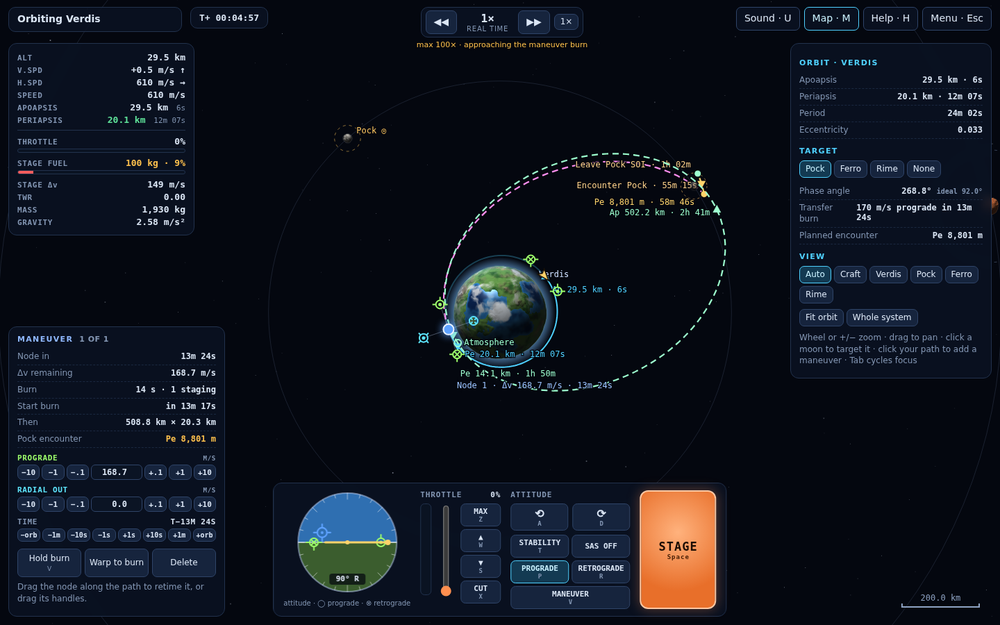
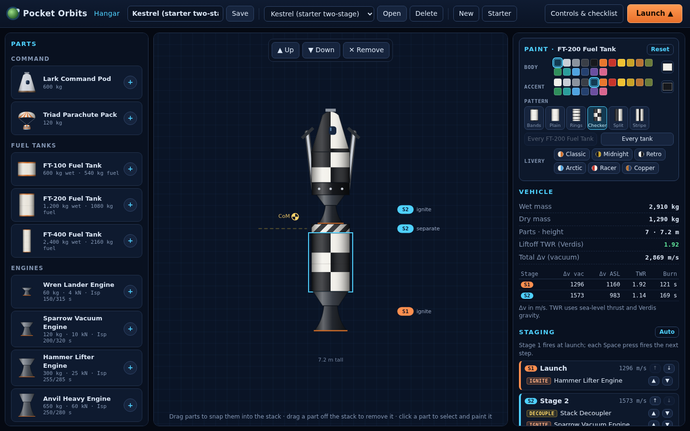
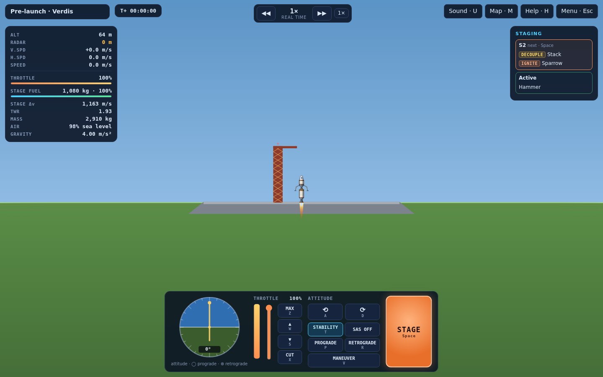
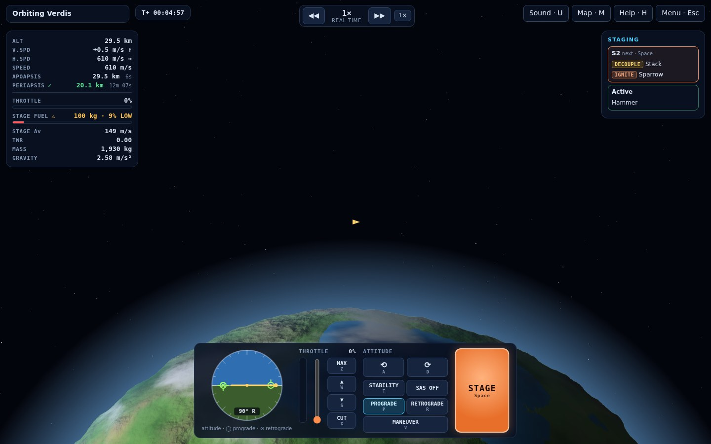
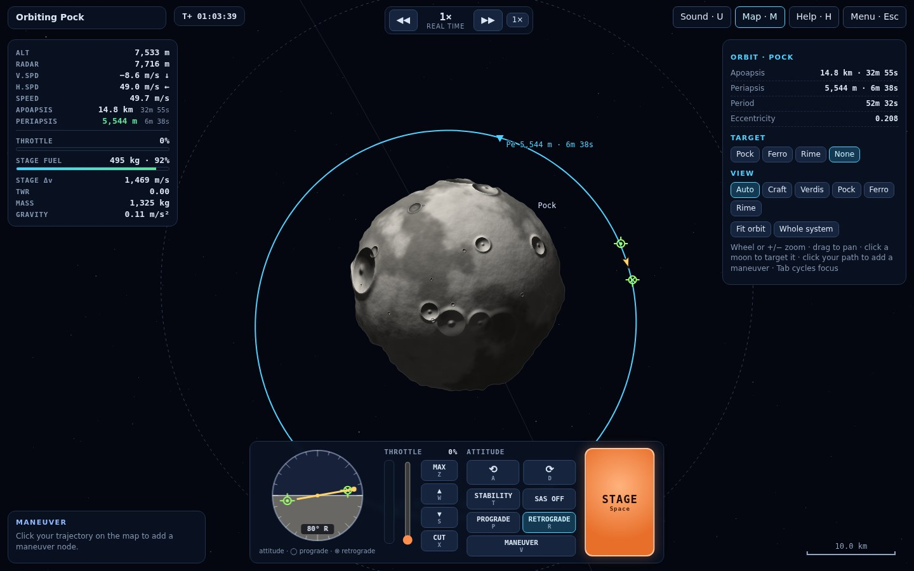
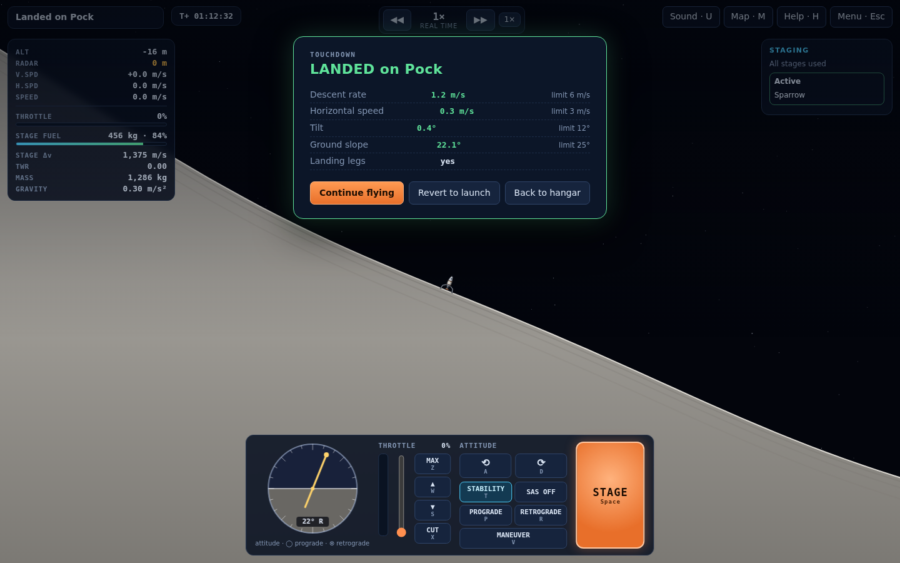
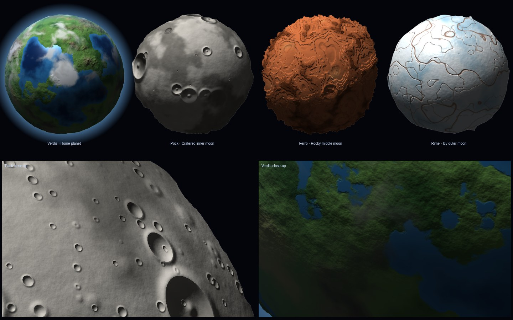
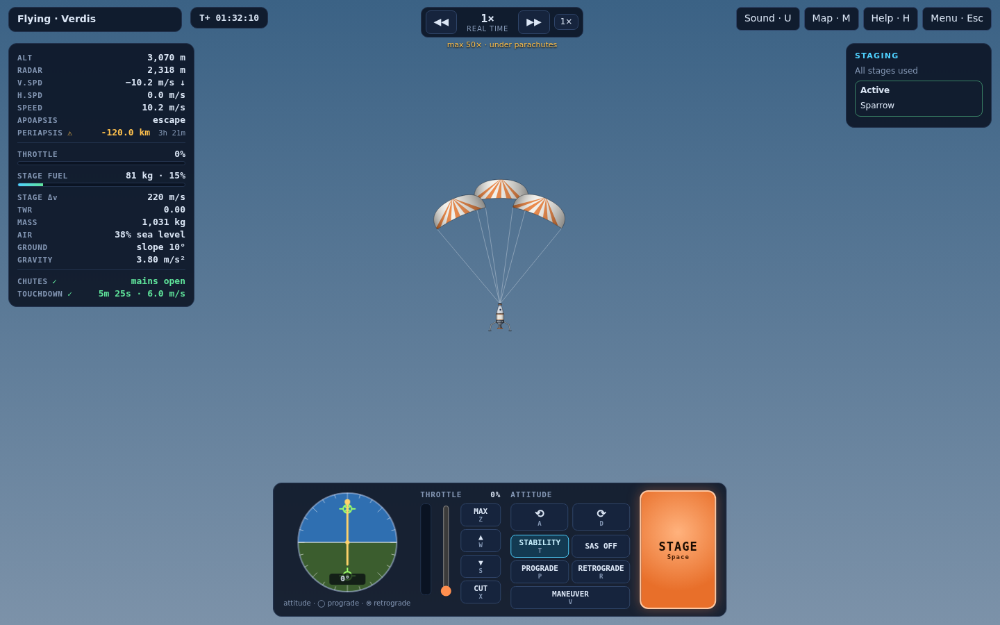
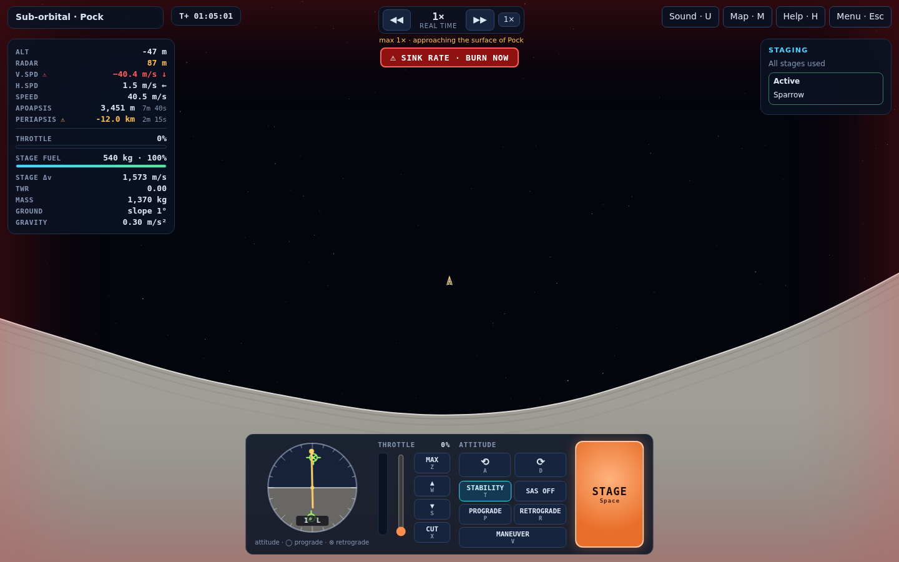

# Pocket Orbits

A small 2D spaceflight sandbox that runs in your browser. Build a rocket, stage it into orbit, plan a transfer with maneuver nodes, and land on a moon.

**[▶ Play it in your browser](https://ognevoa.github.io/pocket-orbits/)**. There's no install and no build step, and it's plain HTML and JavaScript.



## Highlights

- **Hangar.** Snap parts into a stack, rearrange the staging, and see wet mass, liftoff thrust-to-weight and Δv for every stage. Save designs in your browser.
- **Paint every part.** Pick a main and an accent colour, choose a pattern (bands, rings, V-2-style checker, split, racing stripe), or apply a whole-rocket livery. The paint is saved with the design and flies with it.
- **Orbital mechanics.**
  - Inverse-square gravity, drag in a thin atmosphere, and three moons with their own spheres of influence (patched conics).
  - The physics doesn't depend on frame rate.
  - Coasting orbits are calculated exactly, so they never drift.
- **Map and maneuver nodes.**
  - The map predicts your path, with apoapsis, periapsis and moon encounters.
  - Plan burns by dragging handles, and chain a transfer and a capture before you leave orbit.
  - A burn-direction hold makes nodes easy to fly.
  - Labels keep clear of each other, the markers and the panels, and the control deck slims down while the map is open.
- **Cautions and warnings.**
  - A stage running dry, low fuel, and a landing going wrong (sink rate, drift, tilt, steep ground) each get a labelled strip and a chime. The STAGE button pulses when a stage is waiting.
  - *Sink rate · burn now* flashes the screen edges red and beeps.
  - Nothing is shown by colour alone: HUD rows that need attention get a ⚠, and a safe orbit gets a ✓.
- **Parachutes** for coming home to Verdis: arm the pack with Space, and two drogues, then three main canopies, open by themselves when it's safe. The HUD and map give the touchdown time and speed, and time warp goes up to 50× under the mains.
- **Time warp** that slows itself before sphere-of-influence changes, the atmosphere, the ground and planned burns.
- **Landings** judged on descent rate, drift, tilt and slope, with a clear landed or crashed result. Landing legs ride folded against the stack and swing down when their stage fires.
- **Planets rendered on the GPU** from layered 3D noise and craters, lit by one sun with real day and night sides.
- **Synthesised engine sound**: rumble, roar, crackle and turbopump whine, muffled in vacuum. There are no audio files.

## Screenshots

| | |
| --- | --- |
|  |  |
| **Hangar.** Build, paint, stage, check Δv and TWR. | **Ignition.** The starter rocket on the pad, in the Retro livery. |
|  |  |
| **Orbit.** Above Verdis, with clouds and a terminator. | **Lunar orbit.** Captured around cratered Pock. |
|  |  |
| **Touchdown.** Every landing is graded. | **The worlds.** Verdis, Pock, Ferro and Rime. |
|  |  |
| **Home again.** Three mains, the touchdown on the HUD. | **Sink rate.** Warnings you can't miss. |

## Play

- **Online:** <https://ognevoa.github.io/pocket-orbits/>
- **Locally:** open `index.html` in a current Chrome, Edge, Firefox or Safari. It works straight from disk. Or run `python3 -m http.server 8000` in this folder and open <http://localhost:8000>.

Designs and settings are stored in your browser's `localStorage`. Press **H** in flight for the controls and a checklist.

## Your first mission

The hangar opens with **Kestrel**, a ready-to-fly two-stage rocket: 2,910 kg, liftoff TWR 1.92, and 1,296 + 1,573 m/s of Δv. Press **Launch ▲**.

### 1 · Reach orbit
1. The throttle starts at 100%. Press **Space** to light the first stage.
2. At **500 m**, hold **D** until the attitude dial reads **25° R**, then let go.
3. When the green prograde marker on the dial reaches the yellow needle (about 1.5 km up), press **P** to hold prograde. The rocket now turns toward the horizon by itself.
4. When **APOAPSIS** reaches **30 km**, press **X**.
5. Above 15 km, press **.** to warp toward apoapsis, and return to real time about 15 s before it.
6. About **5–10 s before apoapsis**, press **Z**. Press **X** once **PERIAPSIS** passes **20 km**.

You're now in an orbit of about 30 × 20 km, with a little booster fuel left.

### 2 · Fly to the inner moon, Pock
1. Press **M** for the map and click **Pock** to target it. The map panel shows the phase angle and *transfer burn ≈ 170 m/s prograde in …*.
2. Click your path roughly where you'll be at that moment. Then use the node panel's time buttons until **Node in** matches the countdown.
3. Type the suggested Δv into **Prograde**. Fine-tune with **+.1** or **−.1** until the panel shows **Pock encounter Pe 3–9 km**.
4. Click **Warp to burn**, then press **V** to hold the burn direction.
5. When **Start burn** says **NOW**, press **Z**. Press **Space** when the booster runs dry.
6. Ease off with **S** for the last few m/s, and press **X** near zero. The node clears itself.
7. Warp toward the encounter. Warp backs off before Pock's sphere of influence.

You can also skip the node: burn prograde when the countdown runs out, and stop when the map shows the encounter.

### 3 · Capture and land
1. Inside Pock's sphere of influence, warp until periapsis is about 40 s away.
2. Press **R** (hold retrograde) and **Z**. Burn until an apoapsis below 15 km appears, then press **X**. Pock's gravity only reaches about 21.7 km above its surface.
3. To deorbit, burn retrograde until **PERIAPSIS** is below −3 km.
4. Fall with retrograde held. From about **500 m RADAR**, throttle to keep the descent rate near RADAR ÷ 10. If the red **SINK RATE · BURN NOW** warning appears, go to full throttle at once.
5. Below about 50 m, once sideways speed is under 1 m/s, press **T** and stand upright with **A**/**D**.
6. A safe landing with legs needs descent ≤ 6 m/s, sideways speed ≤ 3 m/s, tilt ≤ 12° and ground slope ≤ 25°.

## Controls

| Key | Action | Key | Action |
| --- | --- | --- | --- |
| Space | Next stage | M | Map view |
| W / S, ↑ / ↓ | Throttle up / down (Shift = fine) | Tab | Cycle map focus |
| Z / X | Full throttle / cut throttle | N | Next target moon |
| A / D, ← / → | Rotate left / right | Wheel, + / − | Zoom |
| T | Stability assist on / off | . / , | Warp faster / slower |
| P / R | Hold prograde / retrograde | / | Real time |
| V | Hold the maneuver burn direction | Del | Delete the selected maneuver node |
| U | Sound on / off | H | Help and checklist |
| Esc | Pause menu (volume, revert, hangar) | | |

Every control also has an on-screen button.

**On the map:**
- Click your path to add a maneuver node. Drag the node to move it in time, or drag its green or cyan handles to shape the burn.
- Click a moon to target it, double-click to focus it, and drag to pan.

## The worlds

| Body | Radius | Gravity | Orbit | Sphere of influence | Look |
| --- | --- | --- | --- | --- | --- |
| Verdis (home) | 120 km | 4.0 m/s² | — | — | continents, seas and clouds; atmosphere up to 15 km |
| Pock | 12 km | 0.3 m/s² | 600 km | 33.7 km | grey, densely cratered, dark maria |
| Ferro | 22 km | 0.5 m/s² | 1,300 km | 145.7 km | rust-red terraced ridges and mesas |
| Rime | 35 km | 0.7 m/s² | 2,500 km | 464.6 km | bright ice with long cracks and sharp spires |

A circular orbit 25 km above Verdis takes about 630 m/s. The moons orbit clockwise on the map, the same way you fly after tilting right at launch.

## How it works

**Flight physics.**
- Gravity comes only from the body whose sphere of influence you're in (patched conics). The moons follow circular orbits.
- Powered flight and flight in the atmosphere use fixed 0.02 s RK4 steps, so results don't depend on frame rate.
- Thrust points along the rocket, and Isp blends between its sea-level and vacuum values with air pressure.
- An engine only burns fuel from its own section of the stack, between decouplers.
- Coasting is solved exactly (universal-variable Kepler propagation), which makes high time warp cheap and orbits stable.

**Prediction uses the same code as flight.** The map's path is computed by the same coasting code, with the same sphere-of-influence, atmosphere and terrain events, and its step sizes come from strict speed bounds, so no crossing can be skipped. That also drives time warp: it steps itself down before any predicted event or planned burn. Switching frames at a sphere-of-influence boundary keeps position and velocity exactly.

**Maneuver nodes** store a time plus prograde and radial Δv. The path after each node is predicted with the same rules. While you burn, the next node keeps its planned orbit fixed, so its remaining Δv counts down. Real burns take time while nodes are instant, so a sensitive moon encounter may need a small correction afterwards.

**Landing** is judged on descent rate and sideways speed relative to the surface, tilt (against local vertical or the ground) and ground slope. Landing legs on the bottom stage raise the limits.

**Parachutes** add drag while they're open: two small drogues, then three mains with 280 m² of drag area between them, each filling over a few seconds. They open only when it's safe (the drogues below 8 km and 250 m/s, the mains below 2.5 km and 90 m/s), so the slowdown stays gentle. Under the mains the craft swings to hang straight down, and up to 7 m/s is a safe touchdown. Because the map's path ignores drag, a separate estimate replays the fall with the same rules to give the touchdown time and speed, and time warp uses it to slow down before the ground.

**Alerts** follow the same limits. Sink rate compares the distance your engines need, at full thrust, to slow you to a safe touchdown speed with the height that's left: over 60% of it is a caution, over 90% a warning. Drift, tilt and steep ground are called out close to the ground, and only while you're descending. A descent flown at about RADAR ÷ 10, like the scripted landing in the tests, triggers none of them.

**Planets** are rendered per pixel in a WebGL2 shader.
- *Projection:* the map looks down on the orbital plane, so each body is a sphere seen from above its pole, and its rim is exactly the terrain outline you land on.
- *Surface:* colour and relief come from layered 3D Perlin noise sampled on the sphere, plus crater and ridge height fields. Detail is limited to what the screen can show, so it stays sharp at any zoom, and smaller craters appear as you zoom in.
- *Light and fallback:* a single sun lights everything, and the close-up ground and sky follow the same day and night. Without WebGL2 the game draws flat discs instead.

**Sound** is synthesised with the Web Audio API.
- One engine voice mixes rumble, roar, hiss, a combustion throb, crackle and a turbopump whine.
- Throttle, the firing engines' sound profiles and air pressure shape it. In vacuum, only a muffled rumble remains.
- Ignition, flameout and staging have their own sounds.

**Simplifications:** the world is a single 2D plane, the home planet doesn't rotate, there's no wind, and there's no reentry heating.

## Make it yours

Everything tunable lives in [`js/config.js`](js/config.js):
- the planet, the moons and the launch site;
- the part catalogue (including the parachutes' sizes and opening limits) and the preset rockets, among them *Kestrel Return*, the starter with a parachute pack;
- the warp levels, the landing limits and the caution and warning thresholds;
- each body's texture colours and crater counts, and the sun direction;
- the paint palette, each part role's default colours and patterns, and the liveries;
- each engine's sound profile and the audio levels.

## Project layout

```
index.html          page layout, help and checklist
css/style.css       styles
js/config.js        the editable configuration
js/orbit.js         Kepler propagation, orbital elements
js/system.js        bodies, moon orbits, spheres of influence, atmosphere, terrain
js/craft.js         designs, staging, fuel sections, Δv/TWR analysis
js/paint.js         part paint: colours, patterns, liveries
js/coast.js         shared coasting with event detection, trajectory prediction
js/maneuver.js      maneuver nodes, chained predictions, burn estimates
js/sim.js           flight simulation, warp limiter, alerts, touchdown evaluation
js/planets.js       GPU sphere textures (noise, craters, lighting)
js/render.js        part painter, flight view, map, attitude dial
js/audio.js         synthesised engine and alert sounds
js/hangar.js        hangar UI and saved designs
js/flightui.js      flight HUD, controls, maneuver panel
js/main.js          app shell and game loop
tests/              automated checks and labs
docs/screenshots/   README images
```

## Tests and labs

- [`tests/index.html`](https://ognevoa.github.io/pocket-orbits/tests/) runs the simulation checks in your browser. One of them flies the starter rocket from the pad to the surface of Pock.
- [`tests/planets.html`](https://ognevoa.github.io/pocket-orbits/tests/planets.html) shows every world plus close-ups. Add `?fallback=1` for the 2D version.
- [`tests/audio.html`](https://ognevoa.github.io/pocket-orbits/tests/audio.html) is a sound lab: hear each engine, play a launch sequence, and see the offline waveform checks.
- `python3 tests/run_browser_tests.py all` runs everything in headless Chrome. That includes UI checks driven by real mouse and keyboard input: building and saving designs, flying with the keyboard, maneuver nodes, cautions and warnings, map labels, textures, sound, and a full mission inside the game page. It needs Python 3.9+ with `websockets` and Chrome or Chromium (set `CHROME=/path/to/chrome` to pick one).

The scripted pilots in `tests/pilots.js` fly only with player controls: throttle, rotation, the attitude holds, staging and warp. `python3 tests/capture_screenshots.py` uses them to regenerate the screenshots in `docs/screenshots/` from a real mission (it also needs Pillow).

## License

MIT. See [LICENSE](LICENSE).
